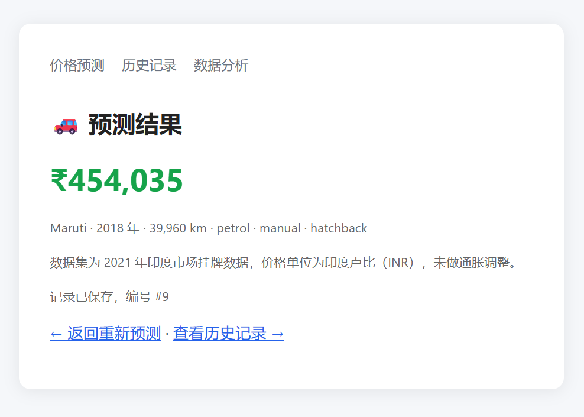
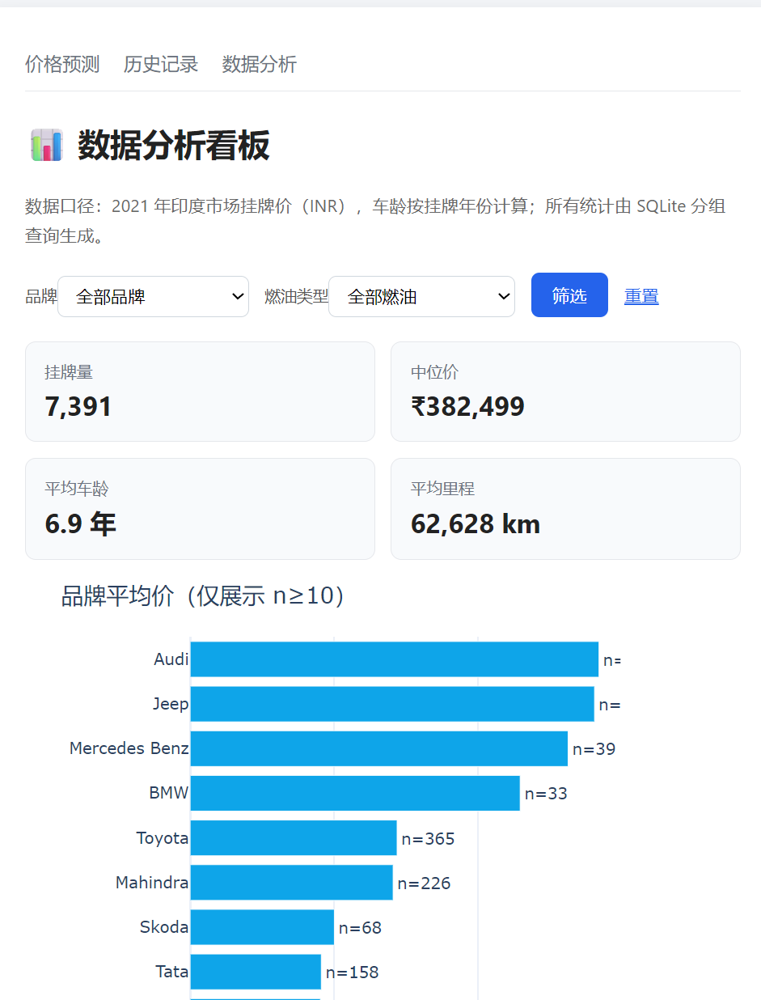
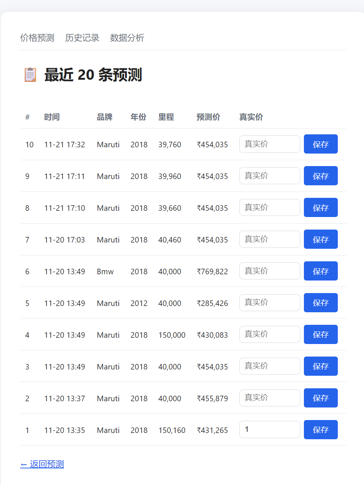

# 二手车价格预测与数据分析服务

基于 7,391 条印度二手车挂牌数据，完成 **EDA → 特征工程 → XGBoost 建模 → 模型评估 → FastAPI + SQLite + Plotly 在线服务** 的完整闭环。


---

## 项目亮点

- **数据口径修正**：发现原始代码用当前年份计算车龄，会把 2021 年的挂牌价误当成 2026 年的车；改用 `ad_created_on` 的挂牌年份后，测试集 R² 从 0.8365 提升到 0.8539。
- **业务单调约束**：对里程、车龄、年均里程、车龄×里程加单调约束，保证"里程越高、车龄越大，价格不会反而上涨"，同时 5 折 CV R² 提升约 1.4 个百分点。
- **训练/推理共用特征模块**：`features.transform()` 被训练、评估和线上推理共同调用，消除 train/serve skew。
- **SQL 分析看板**：把 CSV 装载到 SQLite，用 `GROUP BY / HAVING / CASE WHEN` 做品牌、车龄、里程、年份趋势分析，并通过 Plotly 在网页中交互展示。
- **数据反馈闭环**：每次预测写入 SQLite，支持回填真实成交价，为后续重训留数据。

## 页面截图

| 预测结果 | 数据分析看板 |
|---|---|
|  |  |

| 预测历史 |
|---|
|  |

---

## 关键结果

### 5 折交叉验证

| 模型 | R² (mean ± std) | RMSE | MAE | MdAPE |
|---|---|---|---|---|
| **XGBoost（单调约束）** | **0.8346 ± 0.0153** | 114,257 | 80,280 | 15.2% |
| XGBoost（无约束） | 0.8204 ± 0.0164 | 119,128 | 82,016 | 15.5% |
| Random Forest | 0.7862 ± 0.0215 | 129,908 | 88,933 | 16.2% |
| Linear Regression | 0.4626 ± 0.0174 | 206,753 | 127,787 | 22.3% |
| Dummy（均值） | ≈ 0 | 282,020 | 192,058 | 37.0% |

### 当前部署模型（20% holdout）

| R² | RMSE | MAE | MdAPE |
|---|---|---|---|
| 0.8539 | 111,038 | 79,977 | 15.5% |

> 价格单位均为印度卢比（INR）。数据是 2019–2021 年的挂牌记录，模型价格口径为 **2021 年印度市场**，未做通胀调整。
>
> 平均 MAPE 约 52.7%，主要受少数低价车影响；因此同时报告 **MdAPE（中位绝对百分比误差）15.2%**。相比均值，MdAPE 更能反映典型样本的误差。

---

## 数据与关键洞察

数据来自 Kaggle *Used Car Price Dataset*，原始 7,400 行 × 29 列。清洗后保留 **7,391 行**。

| 洞察 | 结论 |
|---|---|
| 价格分布 | 中位数 38.2 万 INR，均值 45.5 万，偏度 2.77，明显右偏 |
| 车龄 | 与价格相关系数 **-0.515**，是最强数值驱动因素；0–3 年中位价 62.8 万，11–15 年降至 22.9 万 |
| 里程 | 相关系数仅 **-0.105**，且 15 万公里以上中位价反而回升，不能单独用于定价 |
| 品牌 | Maruti（3,175）和 Hyundai（1,798）占大部分挂牌量；豪华品牌样本仅 3–39 条，结论不稳定 |
| 类别变量 | 柴油、自动挡、SUV 中位价更高，但与品牌、车龄混杂，不能做因果解释 |
| 数据质量 | `original_price` 缺失 44%；`transmission` 缺 553 条、`body_type` 缺 101 条，统一记为 `unknown` 或按训练集众数填充 |

完整分析见 [notebooks/01_eda.ipynb](notebooks/01_eda.ipynb)，图表见 [reports/figures/](reports/figures/)。

---

## 项目架构

```
car_data.csv
│
├── train.py + features.py ──→ models/*.pkl ──→ app.py  /（在线预测）
│
├── evaluate.py ─────────────→ reports/metrics.json + SHAP 图
│
├── analytics.py ────────────→ data/analytics.db（listings）
│                                   └──→ app.py  /insights（SQL 看板）
│
├── database.py ─────────────→ data/predictions.db（预测历史 + 反馈）
│
└── notebooks/01_eda.ipynb ──→ reports/figures/*.png + 分析结论
```

### 模型特征

9 个特征：

```
make_encoded, fuel_type_encoded, transmission_encoded, body_type_encoded,
kms_run, Car_Age, Avg_Mileage_Per_Year, Age_Mileage_Interaction, Condition_Score
```

预处理要点：

- 先划分训练/测试，再在训练集上拟合编码映射和 MinMaxScaler，避免数据泄漏
- 类别缺失值用训练集众数填充，填充值保存进 `preprocessor.pkl`
- 训练和推理共用 [features.py](features.py) 的 `transform()`
- 车龄按挂牌年份计算：`Car_Age = ad_year - yr_mfr`

### 可解释性

SHAP 结果显示：**车身类型 > 车龄 > 品牌 > 车况评分 > 燃油类型 > 变速箱**。

- [SHAP 蜂群图](reports/figures/08_shap_summary.png)
- [SHAP 重要性排序](reports/figures/09_shap_bar.png)

车身类型排名靠前，部分原因是 SUV/豪华 SUV 本身是价格段代理；同时也暴露了 LabelEncoder 会给类别强加任意顺序。快速对比实验：

```
LabelEncoder: R² 0.8346, MAE 80,280
One-hot:      R² 0.8293, MAE 80,085
```

性能基本持平，因此保留 LabelEncoder，并在 README 中如实记录这一取舍。

---

## 数据分析看板

访问 `http://127.0.0.1:8002/insights`：

- 4 个 KPI：挂牌量、中位价、平均车龄、平均里程
- 5 张 Plotly 图：品牌平均价、车龄、里程、年份趋势、燃油类型
- 品牌 / 燃油类型筛选
- 所有统计由 SQLite 分组查询生成

示例 SQL：

```sql
SELECT make,
       COUNT(*) AS n,
       AVG(sale_price) AS avg_price
FROM listings
GROUP BY make
HAVING n >= 10
ORDER BY avg_price DESC;
```

---

## 快速开始

### 1. 安装依赖

```bash
python -m venv .venv

# Windows
.venv\Scripts\activate

# macOS / Linux
source .venv/bin/activate

pip install -r requirements.txt
```

### 2. 训练模型

```bash
python train.py
```

输出：

- `models/car_price_model.pkl`
- `models/preprocessor.pkl`

### 3. 启动 Web 服务

```bash
python app.py
```

访问：

- 预测表单：<http://127.0.0.1:8002/>
- 预测历史：<http://127.0.0.1:8002/history>
- 数据分析看板：<http://127.0.0.1:8002/insights>
- 自动生成的 API 文档：<http://127.0.0.1:8002/docs>

### 4. 复现分析与评估（可选）

```bash
pip install -r requirements-dev.txt
python evaluate.py
jupyter notebook notebooks/01_eda.ipynb
```

`evaluate.py` 会生成：

- `reports/model_comparison.csv`
- `reports/metrics.json`
- `reports/figures/08_shap_summary.png`
- `reports/figures/09_shap_bar.png`

### 5. 重建分析表（可选）

```bash
python analytics.py
```

会在 `data/analytics.db` 中重建 `listings` 表；首次启动 `app.py` 时也会自动导入。

---

## API

| 方法 | 路径 | 功能 |
|---|---|---|
| GET | `/` | 预测表单 |
| POST | `/` | 接收车辆信息，返回预测价格并写入数据库 |
| GET | `/history` | 最近 20 条预测记录 |
| POST | `/feedback/{id}` | 回填真实成交价 |
| GET | `/insights` | SQL 数据分析看板 |
| GET | `/health` | 健康检查（部署平台使用） |
| GET | `/docs` | FastAPI 自动生成的接口文档 |

---

## 部署

### Render（推荐）

1. 把项目推到 GitHub
2. Render 控制台 → **New → Web Service** → 选择仓库
3. 配置：

```
Build Command:  pip install -r requirements.txt
Start Command:  uvicorn app:app --host 0.0.0.0 --port $PORT
Health Check:   /health
```

也可以直接使用仓库里的 [render.yaml](render.yaml) 创建 Blueprint。

> 免费实例长时间无访问会休眠，首次打开较慢；SQLite 文件在重新部署后可能重置，预测历史会清空。分析看板会在启动时从 CSV 自动重建，不受影响。

### Docker

```bash
docker build -t used-car-price-service .
docker run -p 8002:8002 used-car-price-service
```

打开 <http://127.0.0.1:8002>。

---

## 项目结构

```
car_price_project/
├── app.py                  # FastAPI 应用：预测、历史、反馈、看板
├── features.py             # 训练/推理共用特征工程
├── train.py                # 训练并保存模型与预处理器
├── evaluate.py             # 5 折 CV、baseline、SHAP
├── analytics.py            # CSV → SQLite listings + SQL 分组统计
├── database.py             # 预测记录 SQLite 模型
├── data/
│   ├── raw/car_data.csv
│   ├── predictions.db      # 运行后生成
│   └── analytics.db        # 运行后生成
├── models/
│   ├── car_price_model.pkl
│   └── preprocessor.pkl
├── notebooks/
│   └── 01_eda.ipynb
├── reports/
│   ├── figures/            # EDA + SHAP 图
│   ├── metrics.json
│   └── model_comparison.csv
├── docs/screenshots/
├── requirements.txt
├── requirements-dev.txt
├── Dockerfile
├── .dockerignore
├── render.yaml
└── README.md
```

---

## 设计取舍

1. **车龄按挂牌年份计算**：数据是 2019–2021 年的挂牌记录；直接用当前年份会把车龄整体高估 5 年。
2. **单调约束**：业务上里程/车龄增加不应导致价格上涨；XGBoost 的 `monotone_constraints` 同时提升了 CV R²。
3. **训练/推理共用 `transform()`**：避免训练和线上特征逻辑不一致；缺失值填充参数也存入 `preprocessor.pkl`。
4. **SQLite**：零部署、单文件，适合演示；通过 SQLAlchemy 接入，后续可平滑切换到 PostgreSQL/MySQL。
5. **两个数据库分开**：`predictions.db` 存线上预测与反馈，`analytics.db` 存分析用 `listings` 表，避免写入互相影响。
6. **MdAPE 补充 MAPE**：低价车会把平均百分比误差拉高，MdAPE 更能代表典型样本。
7. **LabelEncoder + 实验对比**：one-hot 没有带来显著提升，保留实现更简单的 LabelEncoder，并在文档中记录其顺序任意性的局限。

---

## 局限与未来工作

- 数据仅 7,391 行，且全部来自印度市场；价格口径为 2021 年 INR，未做通胀调整。
- 缺少维修保养、事故历史、地区经济水平等关键定价因素。
- 豪华品牌样本很少（Audi 27、BMW 33、Mercedes 39、Volvo 3），品牌效应估计不稳定。
- 当前超参数为固定配置，未做大规模调参；重点放在数据口径、评估严谨性和工程一致性。
- 后续可以：加入目标编码/预测区间、用 Optuna 调参、用反馈数据做增量重训、部署到 Render/Railway、补充 pytest 与 GitHub Actions。

---

## 数据集

Kaggle *Used Car Price Dataset*（印度二手车市场，7,400 条记录，29 个字段）。价格单位为印度卢比（INR）。

## 技术栈

Python · pandas · scikit-learn · XGBoost · SHAP · FastAPI · SQLAlchemy · SQLite · Plotly · Jupyter
